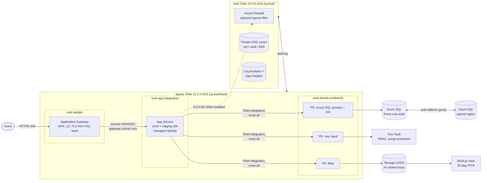

# Azure Landing Zone and Resilient PaaS Platform

[](https://github.com/vishnureddy1922/azure-landing-zone-paas/actions/workflows/ci.yml)

A hub-and-spoke Azure environment, built entirely as code, that runs a Python web app on App Service with Azure SQL and Blob storage behind private endpoints. It covers the day-two side of cloud operations as well as the build: networking, identity and secrets, monitoring and alerting, backup and disaster recovery, policy guardrails, CI/CD with approval gates, and runbooks for production support.

**Stack:** Terraform, Bicep, Azure DevOps Pipelines, GitHub Actions, App Service (Linux), Azure SQL, Storage, VNets, Private Endpoints, Private DNS, NSGs, Application Gateway WAF_v2, Azure Firewall, Key Vault, Microsoft Entra ID, Azure Monitor, Log Analytics, Application Insights, Azure Backup, Azure Policy, Python (Flask).

## Architecture



## What it shows

| Area | Implementation |
|---|---|
| **PaaS and Azure SQL** | Linux App Service with a staging slot and CPU autoscale; Azure SQL serverless with Entra-only authentication; Python app with `/health` (liveness) and `/ready` (checks SQL, Key Vault reference and storage) |
| **Networking** | Hub-and-spoke VNets with peering; three spoke subnets with NSGs; private endpoints and private DNS zones for SQL, Key Vault and Blob; App Service regional VNet integration with route-all; Application Gateway with HTTP-to-HTTPS redirect and health probes; optional Azure Firewall with a UDR forcing app egress through FQDN allow rules |
| **IAM and security** | Managed identities everywhere (no passwords in config); Key Vault RBAC with least-privilege roles; TLS certificate in Key Vault with auto-renewal consumed by the gateway; WAF in Prevention mode; TLS 1.2 minimum; public access disabled on SQL and storage |
| **CI/CD and IaC** | Modular Terraform (7 modules) with remote state; Azure DevOps YAML pipeline: validate (fmt, validate, tflint, Checkov, pytest) → plan → **manual approval** → apply → deploy to staging slot → smoke test → swap; Bicep for KQL log alerts; GitHub Actions CI on every push |
| **Monitoring** | Diagnostic settings from every resource to Log Analytics; Application Insights; metric alerts (5xx, health check, latency, SQL CPU/storage/failed connections/deadlocks, gateway unhealthy hosts); KQL log alerts (WAF block spikes, Key Vault 403s, SQL failed logins); Service Health and Resource Health alerts |
| **Backup and DR** | SQL auto-failover group to the paired region with a listener endpoint; 14-day point-in-time restore and LTR (weekly/monthly/yearly); geo-redundant backup storage; Azure Backup vault for blob data; versioning and soft delete; scripted DR drill that measures RTO |
| **Compliance** | Custom Azure Policy definitions assigned to both resource groups; SQL auditing; Key Vault audit logs; Checkov scanning with a documented exceptions list |

## Repository layout

```
terraform/            Root module and 7 child modules
  modules/network     Hub/spoke VNets, peering, subnets, NSGs, private DNS, optional Azure Firewall + UDR
  modules/monitoring  Log Analytics, App Insights, action group, Service/Resource Health alerts
  modules/security    Key Vault, private endpoint, RBAC, secret, TLS certificate, Azure Policy
  modules/data        Azure SQL primary + DR, failover group, backups/LTR, auditing, metric alerts
  modules/storage     Storage account (private, no shared keys), Backup vault + blob backup
  modules/app         App Service plan, web app, staging slot, autoscale, RBAC, alerts
  modules/edge        Application Gateway WAF_v2, WAF policy, Key Vault TLS, alerts
bicep/monitoring/     KQL scheduled-query alerts
pipelines/            Azure DevOps multi-stage pipeline
.github/workflows/    GitHub Actions CI
app/                  Flask app + pytest tests
scripts/              State bootstrap, DR drill, connectivity triage, DB access grant
docs/                 Runbooks, KQL query library, security findings
```

## Deploy it

### Prerequisites

- Azure subscription where you have **Owner** (the code creates role assignments and policy definitions).
- Azure CLI, Terraform 1.6+, and a Microsoft Entra ID group to administer SQL (`az ad group create --display-name sg-alz-sql-admins --mail-nickname sg-alz-sql-admins`).

### From your machine

```bash
az login
export ARM_SUBSCRIPTION_ID=$(az account show --query id -o tsv)

./scripts/bootstrap-state.sh eastus2          # prints the backend.hcl contents
cd terraform
cp terraform.tfvars.example terraform.tfvars  # set owner, alert_email, SQL group, your IP
# save the bootstrap output as backend.hcl

terraform init -backend-config=backend.hcl
terraform plan -out tfplan
terraform apply tfplan
```

Then:

1. Grant the app database access: run `scripts/grant-app-db-access.sql` as a member of the SQL admin group (replace the app name).
2. Deploy the app: `cd app && zip -r ../app.zip . && az webapp deploy -g <rg> -n <app> --src-path ../app.zip --type zip`.
3. Deploy the log alerts: see the command at the top of `bicep/monitoring/log-alerts.bicep`.
4. Browse to `https://<app_gateway_public_ip>/ready` (self-signed certificate, so use `curl -k`).

### With Azure DevOps

1. Create a service connection `sc-alz-azure` using **workload identity federation**, with Contributor, User Access Administrator and Resource Policy Contributor on the subscription.
2. Create the variable group `alz-terraform` with the variables listed at the top of `pipelines/azure-pipelines.yml`.
3. Create the environment `alz-dev` and add an **Approvals** check — this is the gate between plan and apply.
4. Create a pipeline from `pipelines/azure-pipelines.yml`.

## Cost control

Application Gateway WAF_v2 and Azure Firewall are the expensive parts. Defaults keep the firewall off. For practice, deploy, test, and destroy on the same day:

```bash
terraform destroy
```

Use the [Azure pricing calculator](https://azure.microsoft.com/pricing/calculator/) for current prices in your region. Set `enable_app_gateway = false` and `enable_geo_dr = false` for the cheapest run (the app is then reachable directly over HTTPS).

## Operations

- [Incident triage runbook](docs/runbooks/incident-triage.md)
- [Azure SQL disaster recovery runbook](docs/runbooks/sql-failover-dr.md)
- [Secrets and certificate rotation runbook](docs/runbooks/secrets-and-certificates.md)
- [KQL query library](docs/kql-queries.md)
- [Security findings and decisions](docs/security-findings.md)

## Next steps

- Self-hosted Azure DevOps agent inside the hub VNet, so Key Vault public access can be turned off completely.
- Second App Service in the paired region behind Azure Front Door for full regional failover of the web tier.
- Azure Monitor workbook for an at-a-glance operations dashboard.

## License

MIT
